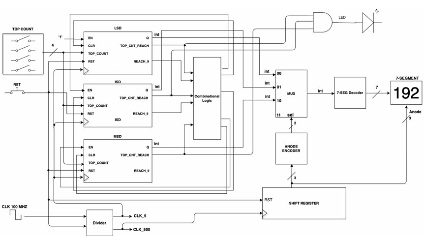
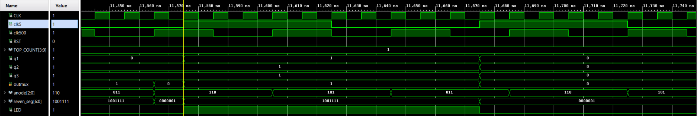

# FPGA Basys3 3-Digit Decimal Counter

A modular VHDL implementation of a 3-digit decimal counter system for the Digilent Basys3 FPGA board.

The system counts from `000` up to a user-selected value `NNN`, where `N` is selected using four input switches. The current value is displayed on three digits of the Basys3 7-segment display, and an LED is turned on only when the counter reaches the selected maximum value.

---

## Project Goal

The goal of this project is to design a complete synchronous FPGA system using reusable VHDL components.

The design combines clock division, cascaded decimal counters, 7-segment display multiplexing, anode control, decimal decoding, and FPGA pin constraints into one working hardware system.

---

## Hardware Platform

| Item | Description |
|---|---|
| FPGA board | Digilent Basys3 |
| FPGA family | Xilinx Artix-7 |
| HDL | VHDL |
| Toolchain | Xilinx Vivado |
| Input clock | 100 MHz |
| Display | On-board 4-digit 7-segment display |
| Used display digits | 3 digits |
| Input control | 4 switches for `top_count` |
| Reset | Synchronous active-high reset |
| Output indication | LED turns on at `NNN` |

---

## System Behavior

The system receives a 4-bit input called `top_count`.

`top_count` represents the decimal digit `N` in the range `0` to `9`:

| `top_count` | Decimal N | Counter Range |
|---|---:|---|
| `0001` | 1 | `000` to `111` |
| `0010` | 2 | `000` to `222` |
| `0101` | 5 | `000` to `555` |
| `1001` | 9 | `000` to `999` |

When the counter reaches `NNN`, the LED is asserted. On the next counting cycle, the system clears back to `000`.

Example for `top_count = 0001`:

```text
000 → 001 → 002 → ... → 111 → 000
```

Values above `1001` are not used because each counter digit is decimal and supports values from `0` to `9`.

---

## System Architecture

The design is divided into small components, where each component has one clear responsibility.



The top-level module connects the clock generation logic, three decimal counters, display multiplexing logic, 7-segment decoding, and output LED logic.

---

## Top-Level Module

### `main.vhd`

`main.vhd` is the top-level entity of the system.

It connects all internal components and handles the main control logic:

- Instantiates the clock divider.
- Instantiates three decimal counters.
- Connects the display multiplexing path.
- Generates the clear and enable signals for the counter chain.
- Drives the LED when the counter reaches `NNN`.
- Disables the unused fourth 7-segment digit using `a3`.

Important internal signals include:

| Signal | Purpose |
|---|---|
| `clk5` | Slow clock used for counter updates |
| `clk500` | Faster clock used for display multiplexing |
| `q1` | Ones digit |
| `q2` | Tens digit |
| `q3` | Hundreds digit |
| `toprch1`, `toprch2`, `toprch3` | Indicate when each digit reached `N` |
| `allrchtop` | Indicates that the full number reached `NNN` |
| `rch91`, `rch92` | Used for carry logic between decimal counters |
| `toanode` | Active-low anode rotation pattern |
| `sel` | Select signal for the digit MUX |
| `todec` | Decimal digit currently sent to the 7-segment decoder |

---

## Component Overview

### 1. Clock Divider — `divider.vhd`

The `divider` component receives the 100 MHz Basys3 clock and generates two slower clock signals:

| Output Clock | Purpose |
|---|---|
| `clk5` | Updates the decimal counter |
| `clk500` | Refreshes the multiplexed 7-segment display |

The divider uses generic half-period cycle counts:

```vhdl
clk500Hz : integer := 100000;
clk5Hz   : integer := 10000000;
```

The generated frequency is determined by:

```text
Fout = Fin / (2 × N)
```

For a 100 MHz input clock:

| Generic Value | Output Frequency |
|---:|---:|
| `10,000,000` | 5 Hz |
| `100,000` | 500 Hz |

#### `rdy_rst` behavior

The divider includes an internal signal called `rdy_rst`.

Its role is to make reset act as a controlled one-time reinitialization event for the divider. When reset is first sampled high, the divider counters are cleared and the generated clocks restart from a known state. After that first reset cycle, `rdy_rst` prevents the divider from being continuously cleared every clock cycle while reset remains high.

This means the divider is restarted cleanly at the beginning of reset, instead of being held permanently stopped for as long as the reset input remains high.

---

### 2. Decimal Counter — `counter.vhd`

The `counter` component implements a single decimal digit counter from `0` to `9`.

The top-level design uses three instances of this component:

| Instance | Digit |
|---|---|
| `cnt1` | Ones digit |
| `cnt2` | Tens digit |
| `cnt3` | Hundreds digit |

Each counter receives:

| Input | Purpose |
|---|---|
| `clk` | Counter clock |
| `rst` | Synchronous reset |
| `en` | Enables counting |
| `clr` | Clears the digit to zero |
| `top_count` | Selected maximum digit `N` |

Each counter outputs:

| Output | Purpose |
|---|---|
| `q` | Current digit value |
| `reach_9` | Indicates that the digit reached 9 |
| `top_cnt_reach` | Indicates that the digit reached the selected `N` |

The counters are cascaded using enable and clear signals. The ones digit counts continuously, the tens digit advances when the ones digit reaches 9, and the hundreds digit advances when both lower digits reach 9.

---

### 3. Shift Register — `Shift_REG.vhd`

The `Shift_REG` component controls which 7-segment digit is active at each moment.

The Basys3 7-segment display uses active-low anodes, meaning:

```text
0 = digit enabled
1 = digit disabled
```

The shift register rotates a 3-bit active-low pattern:

```text
110 → 101 → 011 → 110 → ...
```

This allows the system to rapidly switch between the three active display digits. Because this switching happens fast enough, the human eye sees all digits as if they are displayed at the same time.

---

### 4. Anode Encoder — `anode_encoder.vhd`

The `anode_encoder` receives the active anode pattern from the shift register and converts it into a 2-bit select signal for the MUX.

This allows the display logic to know which counter digit should currently be sent to the 7-segment decoder.

| Active Anode Pattern | Selected Digit |
|---|---|
| `110` | Ones digit |
| `101` | Tens digit |
| `011` | Hundreds digit |

---

### 5. Digit Multiplexer — `mux4x1.vhd`

The `mux4x1` component selects one of the three decimal counter values and forwards it to the 7-segment decoder.

Inputs:

- `q1` — ones digit
- `q2` — tens digit
- `q3` — hundreds digit
- `sel` — digit select signal from the anode encoder

Output:

- `todec` — the selected decimal digit

The selected digit changes together with the active anode, which is what makes the multiplexed display work correctly.

---

### 6. 7-Segment Decoder — `Seg_decoder.vhd`

The `Seg_decoder` component converts the selected decimal digit into the correct 7-segment output pattern.

Input:

- Integer digit from `0` to `9`

Output:

- 7-bit segment vector connected to the display cathodes

The Basys3 7-segment signals are active-low, so a segment is turned on by driving it low.

```text
0 = segment ON
1 = segment OFF
```

---

### 7. Constraints File — `Basys3.xdc`

The constraints file maps the VHDL top-level ports to the physical Basys3 FPGA pins.

It connects:

| VHDL Signal | Basys3 Peripheral |
|---|---|
| `clk_100M` | 100 MHz board clock |
| `reset` | Push button |
| `top_count[3:0]` | Switches |
| `seven_seg[6:0]` | 7-segment cathodes |
| `anode[2:0]` | Three active 7-segment anodes |
| `a3` | Disabled fourth anode |
| `led` | On-board LED |

---

## Counting and Carry Logic

The system uses three decimal counters connected as a cascaded counter chain.

The main counting logic is implemented in `main.vhd`:

- `cnt1` is always enabled.
- `cnt2` is enabled when `cnt1` reaches 9.
- `cnt3` is enabled when both `cnt1` and `cnt2` reach 9.
- When all three digits reach the selected value `N`, `allrchtop` becomes high.
- When `allrchtop` is high, the LED turns on and all digits clear back to zero on the next counter update.

This creates a decimal counting sequence from `000` to `NNN`.

---

## Display Multiplexing

Only one physical 7-segment digit is active at a time, but the active digit changes quickly using the `clk500` clock.

The display path is:

1. `Shift_REG` selects the active anode.
2. `anode_encoder` converts the active anode into a MUX select value.
3. `mux4x1` selects the matching decimal digit.
4. `Seg_decoder` converts the digit into segment signals.
5. The selected digit appears on the active 7-segment display.

The fourth 7-segment digit is not used and is disabled by holding `a3` high.

---

## Simulation

The project includes testbenches for the full system and selected components.

| Testbench | Purpose |
|---|---|
| `tb_main.vhd` | Full-system simulation |
| `tb_div.vhd` | Clock divider verification |
| `tb_counter.vhd` | Single decimal counter verification |

For simulation, the divider generic values are reduced so the system can be verified quickly.

Example from `tb_main.vhd`:

```vhdl
generic map (
    CLK500_HALF_PERIOD_CYCLES => 2,
    CLK5_HALF_PERIOD_CYCLES   => 5
)
```

With a 10 ns input clock period:

| Signal | Toggle Interval | Full Period |
|---|---:|---:|
| `clk500` | 20 ns | 40 ns |
| `clk5` | 50 ns | 100 ns |

---

## Simulation Result

The waveform below shows the top-level system simulation.

In this example, `top_count` is set to `1`, so the system counts up to `111`. When the digits reach `111`, the LED turns on. On the next count cycle, the counter clears back to `000` while the anode signal continues rotating for display multiplexing.



---

## Repository Structure

```text
3_Digit_Decimal_Counter/
├── README.md
├── src/
│   ├── main.vhd
│   ├── divider.vhd
│   ├── counter.vhd
│   ├── Shift_REG.vhd
│   ├── anode_encoder.vhd
│   ├── mux4x1.vhd
│   └── Seg_decoder.vhd
├── sim/
│   ├── tb_main.vhd
│   ├── tb_div.vhd
│   └── tb_counter.vhd
├── constraints/
│   └── Basys3.xdc
└── images/
    ├── System_Block_Diagram.png
    └── Simulation_Waveform.png
```

---

## How to Run the Project

### 1. Create a Vivado Project

Create a new RTL project in Xilinx Vivado and select the Digilent Basys3 board or the matching Artix-7 FPGA device.

### 2. Add Source Files

Add all VHDL source files from the `src/` directory.

Set `main.vhd` as the top-level module.

### 3. Add Constraints

Add the Basys3 constraints file from:

```text
constraints/Basys3.xdc
```

### 4. Run Behavioral Simulation

Add the testbench files from the `sim/` directory and run `tb_main.vhd` to simulate the full system.

### 5. Generate Bitstream

Run synthesis, implementation, and bitstream generation.

### 6. Program the FPGA

Connect the Basys3 board and program it using Vivado Hardware Manager.

---

## Design Notes

- The design is fully synchronous.
- Reset is active-high.
- The counter operates on decimal digits, not hexadecimal values.
- Valid `top_count` values are `0000` to `1001`.
- The 7-segment display uses active-low anodes and active-low segment signals.
- Only three display digits are used; the fourth digit is disabled.
- The divider uses reduced generic values during simulation and real hardware values during FPGA implementation.

---

## License

This project is intended for educational and portfolio purposes.
