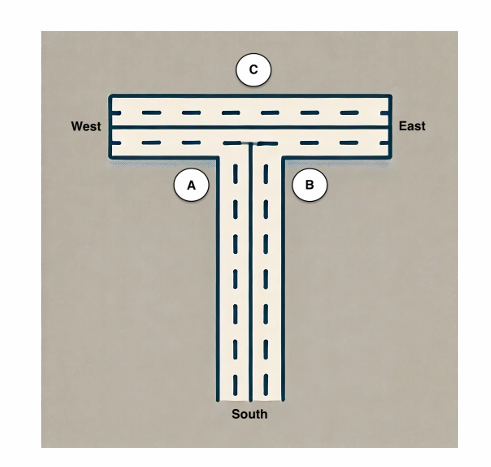
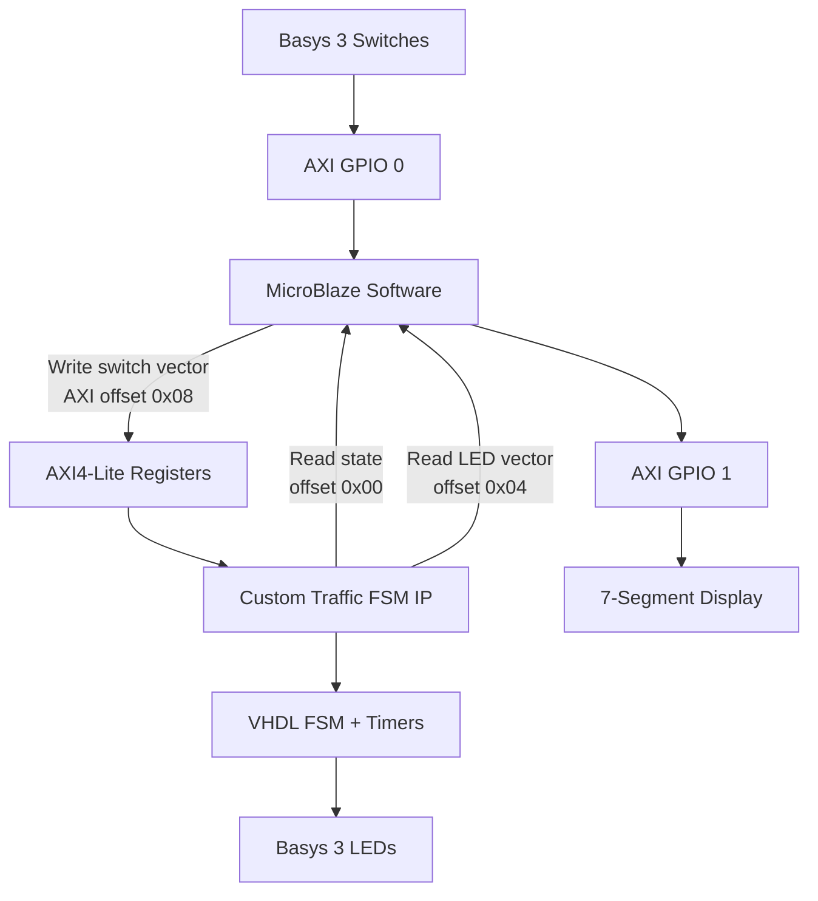
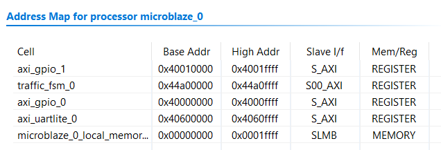
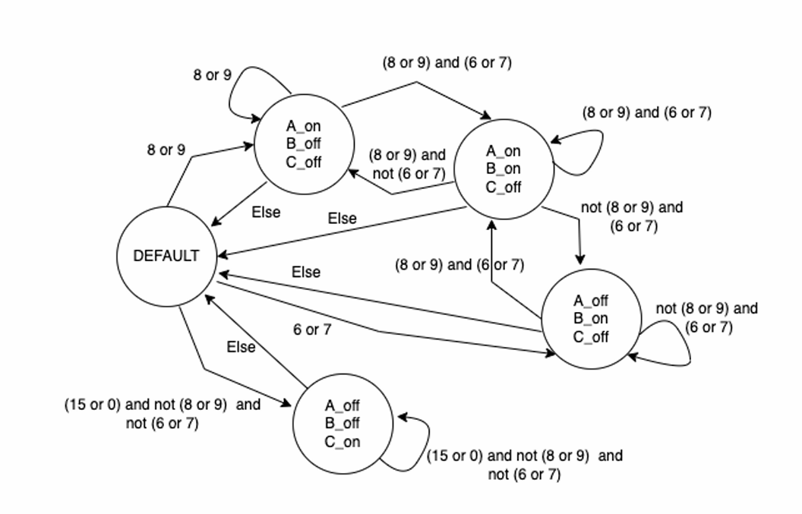
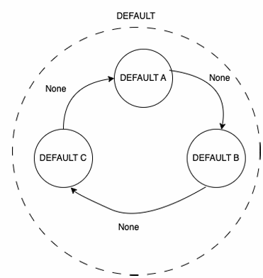
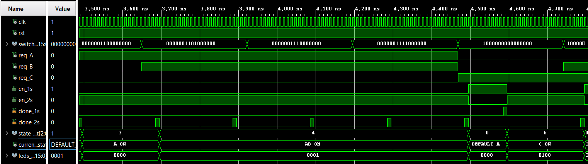

# MicroBlaze AXI Custom IP Traffic Light Controller
  
  
  
  
  
  
  

## Overview

This project implements an FPGA-based traffic light controller on the **Basys 3** board using **VHDL**, **MicroBlaze soft processor**, and a custom **AXI4-Lite IP core**.

The traffic-control logic is implemented in hardware as a finite state machine (FSM). The MicroBlaze processor is used to read the physical switch inputs, forward them to the custom AXI IP, monitor the FSM state, read the LED output, drive the 7-segment display, and print status information through UART.

The system combines:

- VHDL traffic-light FSM
- 1-second and 2-second hardware timer modules
- Custom AXI4-Lite IP wrapper
- MicroBlaze software application in C
- Basys 3 switches, LEDs, and 7-segment display
- VHDL simulation testbench that verifies all relevant switch combinations

The main design idea is that the **traffic decision logic runs fully in hardware**, while the MicroBlaze handles system monitoring and user interface tasks.

---

## Repository Structure

```text
MicroBlaze_AXI_Custom_IP_Traffic_Light_Controller/
│
├── DOCS/
│   ├── junction_layout.png
│   ├── fsm_main_diagram.png
│   ├── default_state_cycle.png
│   ├── block_design.png
│   ├── address_map.png
│   └── tb_traffic.png
│
├── SDK_code/
│   └── main.c
│
├── constrs/
│   └── Bayss3.xdc
│
├── traffic_fsm_IP/
│   ├── HDL/
│   │   ├── traffic_fsm_v1_0.vhd
│   │   └── traffic_fsm_v1_0_S00_AXI.vhd
│   │
│   ├── src/
│   │   ├── state_machine.vhd
│   │   ├── timer.vhd
│   │   └── traffic_top.vhd
│   │
│   └── sim/
│       └── tb_traffic_top.vhd
│
└── README.md
```

---

## Traffic Junction and Input Mapping

The controller models a traffic junction with three traffic-light groups: **A**, **B**, and **C**.

Each selected Basys 3 switch represents a vehicle request from one direction to another. The FSM receives these switch inputs and decides which traffic light group should be active.

<p align="center">
  
</p>


<div align="center">
  
### Switch / Vehicle Request Mapping

| Switch Bit | From | To | Traffic Light Group |
|---:|---|---|:---:|
| `SW15` | West | East | C |
| `SW9`  | West | South | A |
| `SW8`  | South | West | A |
| `SW7`  | South | East | B |
| `SW6`  | East | South | B |
| `SW0`  | East | West | C |

</div>

<p align="center">
Only these six switches are used as traffic sensors.<br>
All other switch bits are ignored by the traffic controller.
</p>

---

## System Architecture and Vivado Block Design

The system is built around a MicroBlaze processor connected to several AXI peripherals.

The physical switches are read through `axi_gpio_0`. The MicroBlaze software reads these switch values and writes the switch vector into the custom AXI4-Lite traffic FSM IP. Inside the custom IP, the VHDL traffic controller uses this vector as the vehicle request input.

The traffic FSM generates the LED output directly from hardware. In parallel, the current FSM state and LED vector are exposed through AXI readable registers, allowing the MicroBlaze software to monitor the hardware state.

The MicroBlaze also uses the current FSM state to update the 7-segment display through `axi_gpio_1`.



<div align="center">
  
### Vivado Block Design
</div>


---

### Main Vivado Components

The following table summarizes the main IP blocks used in the block design and their roles in the system.

| Component | Role |
|---|---|
| `microblaze_0` | Soft processor used to run the C application |
| `traffic_fsm_0` | Custom AXI4-Lite IP containing the traffic-light hardware logic |
| `axi_gpio_0` | Reads the 16-bit Basys 3 DIP switches |
| `axi_gpio_1` | Drives the 7-segment display |
| `axi_uartlite_0` | Provides UART communication |
| `microblaze_0_axi_periph` | AXI interconnect between MicroBlaze and peripherals |
| `clk_wiz_1` | Clock generation |
| `rst_clk_wiz_1_100M` | Reset synchronization |


### Address Map

The address map defines how the MicroBlaze accesses each memory-mapped peripheral. The custom traffic FSM IP is mapped as an AXI4-Lite slave peripheral and is accessed by the software using its base address.


---

## Hardware Design and FSM Logic

The hardware logic is written in VHDL. The internal traffic controller is separated from the AXI wrapper, which makes the FSM easier to simulate and verify independently.

### VHDL Files

| File | Role |
|---|---|
| `state_machine.vhd` | Main traffic-light FSM |
| `timer.vhd` | Generic timer module |
| `traffic_top.vhd` | Connects the FSM and timer modules |
| `traffic_fsm_v1_0.vhd` | Top wrapper of the custom AXI IP |
| `traffic_fsm_v1_0_S00_AXI.vhd` | AXI4-Lite slave interface and register logic |

The internal hardware core is built from:

```text
traffic_top
├── timer 1s
├── timer 2s
└── traffic_fsm
```

The AXI wrapper instantiates `traffic_top` inside the custom IP and connects it to AXI registers.

### FSM State Encoding

| State Code | State Name | Description |
|---|---|---|
| `000` | `DEFAULT_A` | Default scan state, traffic light A active |
| `001` | `DEFAULT_B` | Default scan state, traffic light B active |
| `010` | `DEFAULT_C` | Default scan state, traffic light C active |
| `011` | `A_ON` | Group A request is served |
| `100` | `AB_ON` | Groups A and B are served together |
| `101` | `B_ON` | Group B request is served |
| `110` | `C_ON` | Group C request is served |

### LED Output Mapping

| Traffic Light Group | LED Bit |
|---|---:|
| A | `LED15` |
| B | `LED0` |
| C | `LED8` |

<div align="center">
  
### FSM Diagram
When no vehicle request is active, the FSM cycles between the default states.  
When a request is detected, the FSM moves to the matching service state.



  
### Default State Cycle


</div>
The default cycle is:

```text
DEFAULT_A → DEFAULT_B → DEFAULT_C → DEFAULT_A
```

### FSM Timing Control

| Timer | Purpose |
|---|---|
| 1-second timer | Used while cycling through the default states |
| 2-second timer | Used while serving an active traffic request |

The `timer.vhd` module asserts `done` for one clock cycle when the selected delay expires. 

---

## AXI4-Lite Interface

The custom IP exposes four 32-bit AXI4-Lite registers. The MicroBlaze writes the switch vector into the custom IP and reads back the current FSM state and LED output.

### Custom IP Register Map

| Offset | Register | Direction | Description |
|---:|---|---|---|
| `0x00` | State Register | Read | Current FSM state |
| `0x04` | LED Register | Read | Current LED output vector |
| `0x08` | Switch Register | Write | Switch/request input written by MicroBlaze |
| `0x0C` | Reserved | - | Unused |

---

## MicroBlaze Software

The MicroBlaze software is implemented in `SDK_code/main.c`.

The software does not decide which traffic light should be active.  
That decision is made by the VHDL FSM inside the custom IP.

Instead, the software performs system-level control and monitoring.

### 7-Segment Display

The 7-segment display shows the currently active traffic-light group.

| FSM State | Displayed Output |
|---|---|
| `DEFAULT_A` | `A` |
| `DEFAULT_B` | `B` |
| `DEFAULT_C` | `C` |
| `A_ON` | `A` |
| `AB_ON` | `A..B` |
| `B_ON` | `B` |
| `C_ON` | `C` |

### Software Build Size

The compiled MicroBlaze software size was measured using the ELF size report:

```text
text    data    bss     dec     hex     filename
12760   692     3228    16680   4128    traffic_light_driver.elf
```

| Section | Size [bytes] | Description |
|---|---:|---|
| `.text` | 12,760 | Program code and read-only constants |
| `.data` | 692 | Initialized global/static variables |
| `.bss` | 3,228 | Uninitialized global/static variables |
| Total | 16,680 | Total memory footprint |
| Hex | `0x4128` | Total size in hexadecimal |

The total software footprint is approximately **16.3 KB**.  
In this design, the MicroBlaze local memory range is `0x00000000` to `0x0001FFFF`, which provides **128 KB** of local memory. Therefore, the application uses only about **12.7%** of the available local memory.

---

## Simulation and Verification

The VHDL testbench verifies the traffic controller hardware independently from the MicroBlaze processor.

The simulation uses `tb_traffic_top.vhd`, which instantiates the internal `traffic_top` module directly. This allows the FSM and timers to be tested before integration into the AXI custom IP.



In the shown simulation window, the switch vector changes between different request combinations.  
The decoded request signals `req_A`, `req_B`, and `req_C` respond according to the active switch bits.

The `en_1s` and `en_2s` signals indicate which timer is currently enabled.  
The `done_1s` and `done_2s` pulses show when the selected timer has finished counting and the FSM is allowed to transition.

The FSM transitions between states such as `A_ON`, `AB_ON`, `DEFAULT_A`, and `C_ON`.  
The `state_out` / `current_state` signals show the active FSM state, and `leds_out[15:0]` changes according to that state.

Overall, the waveform confirms that the requests are decoded correctly, the timers control the state transitions and the LED output matches the active traffic-light state.

### Simulation Timing

For simulation only, the timer clock-frequency generic is reduced:

```vhdl
TB_CLK_FREQ_HZ : positive := 10;
```

This allows the testbench to simulate the 1-second and 2-second timers much faster:

| Simulated Timer | Simulation Equivalent |
|---|---|
| 1 second | 10 clock cycles |
| 2 seconds | 20 clock cycles |

This makes the waveform easier to inspect and keeps the simulation runtime short.

---

## Summary

This project demonstrates a complete hardware/software co-design flow on an FPGA platform.

The main value of the design is the separation between real-time hardware control and processor-based system management. The traffic-light decision logic runs inside a custom VHDL hardware core, while the MicroBlaze processor communicates with it through a memory-mapped AXI4-Lite interface.

This structure shows how custom digital logic can be integrated into a processor-based embedded system, verified independently in simulation, and then connected to real board peripherals such as switches, LEDs, UART, and a 7-segment display.

Overall, this project is a practical example of integrating a custom AXI4-Lite hardware controller with an embedded soft processor on the Basys 3 FPGA board.

