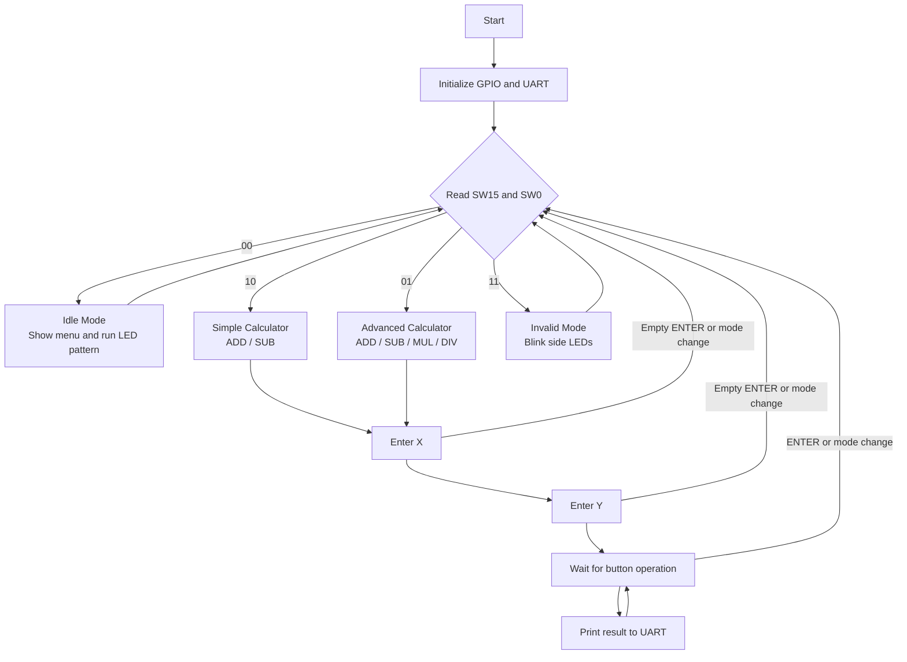

# MicroBlaze Calculator System


## Overview

This project implements an embedded calculator system on the Basys3 FPGA board using a Xilinx MicroBlaze soft processor.

The firmware was designed as a compact, resource-aware embedded application. 

The system is controlled through board switches, push buttons, LEDs, a 4-digit 7-segment display, and UART terminal communication.

The calculator supports four operating modes:

| Mode | Switch Setting | Supported Operations |
|---|---|---|
| Idle Mode | `SW15 = 0`, `SW0 = 0` | Mode selection screen and LED pattern |
| Simple Calculator | `SW15 = 1`, `SW0 = 0` | ADD, SUB |
| Advanced Calculator | `SW15 = 0`, `SW0 = 1` | ADD, SUB, MUL, DIV |
| Invalid Mode | `SW15 = 1`, `SW0 = 1` | Warning message and blinking side LEDs |

## Project Goal

The goal of this project is to demonstrate a complete FPGA-based embedded system that combines hardware design in Vivado with modular C firmware running on a MicroBlaze soft processor.

This project demonstrates:

- MicroBlaze soft processor system design
- Compact memory-aware implementation for a resource-limited FPGA system
- AXI GPIO peripheral integration
- Bare-metal modular C firmware
- UART-Lite terminal communication with non-blocking input handling
- Switch and push-button input handling
- LED and 7-segment display control
- State-machine based calculator logic
- Manual floating-point input parsing

## Hardware Architecture

The Vivado hardware system includes:

| Peripheral | Purpose |
|---|---|
| MicroBlaze | Soft processor running the C firmware |
| AXI GPIO 0 | DIP switches and LEDs |
| AXI GPIO 1 | 7-segment anodes and segment display |
| AXI GPIO 2 | Push-button inputs |
| AXI UART-Lite | UART terminal communication |
| Clock / Reset | System clock and reset logic |

## Vivado Block Design

<p align="center">
  
</p>

## AXI Address Map

<p align="center">
  
</p>

## Firmware Structure

The firmware is written in C and organized into modular functions.

| Function | Description |
|---|---|
| `main()` | Main program loop. Continuously checks the selected mode and calls the matching system function |
| `Initialize()` | Initializes AXI GPIO peripherals and UART-Lite |
| `ReadSwitches()` | Reads the 16 DIP switch values |
| `ReadSwMode()` | Extracts the mode bits from `SW15` and `SW0` |
| `ReadButtons()` | Reads the push-button GPIO input |
| `WriteLeds()` | Writes values to the 16 board LEDs |
| `LedPatt()` | Runs the menu moving LED animation |
| `put7SEG()` | Writes one active anode and one segment pattern to the 7-segment display |
| `Write7SEG()` | Displays a 4-character word using 7-segment multiplexing |
| `Decode7Seg()` | Converts a character into an active-low 7-segment pattern |
| `ClearScreen()` | Clears the UART terminal using ANSI escape sequences |
| `UartTryGetChar()` | Reads one UART character without blocking the program |
| `UartSendChar()` | Sends one character through UART-Lite |
| `UartSendUnsignedInt()` | Sends an unsigned integer through UART without using heavy formatted printing |
| `UartSendFloat3()` | Sends a floating-point number with 3 decimal digits |
| `ProcessInputChar()` | Builds and parses signed decimal input from UART characters |
| `simpleCalc()` | Runs Simple Calculator mode: ADD and SUB |
| `advancedCalc()` | Runs Advanced Calculator mode: ADD, SUB, MUL, and DIV |

## System Flow

The main loop continuously checks the selected mode using `SW15` and `SW0`.  
Each calculator mode then runs its own internal input flow.



In Simple mode, only ADD and SUB are accepted.  
In Advanced mode, ADD, SUB, MUL, and DIV are accepted.  
After a result is printed, the same operands remain active, so the user can press another operation button or press ENTER to restart the input flow.

## Static ELF Memory Footprint

After building the MicroBlaze application, the generated ELF file size was:

| Section | Size (bytes) | Approx. KiB | Meaning |
|---|---:|---:|---|
| `text` | 25,024 | 24.44 | Program code and read-only data |
| `data` | 700 | 0.68 | Initialized global/static variables |
| `bss` | 3,244 | 3.17  | Uninitialized global/static variables |
| `dec` | 28,968 | 28.29  | Total static size |
| `hex` | `0x7128` | — | Total size in hexadecimal |

KiB means kibibytes, where 1 KiB = 1024 bytes.

```text
text    data    bss     dec     hex     filename
25024   700     3244    28968   7128    microblaze_gpio.elf
```
The total static footprint is only 28,968 bytes, approximately 28.29 KiB. This is compact for a MicroBlaze bare-metal application that handles GPIO control, UART-Lite communication, 7-segment multiplexing, input parsing, and calculator logic.

This footprint represents the static ELF size after compilation. It does not include dynamic stack usage during runtime.


