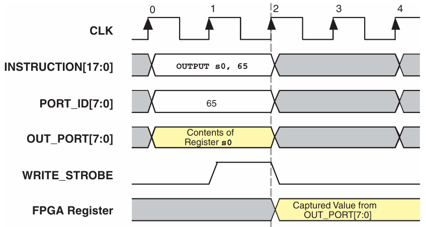
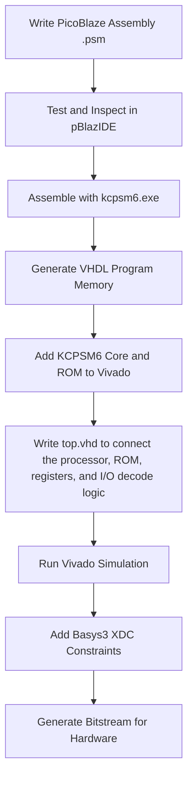
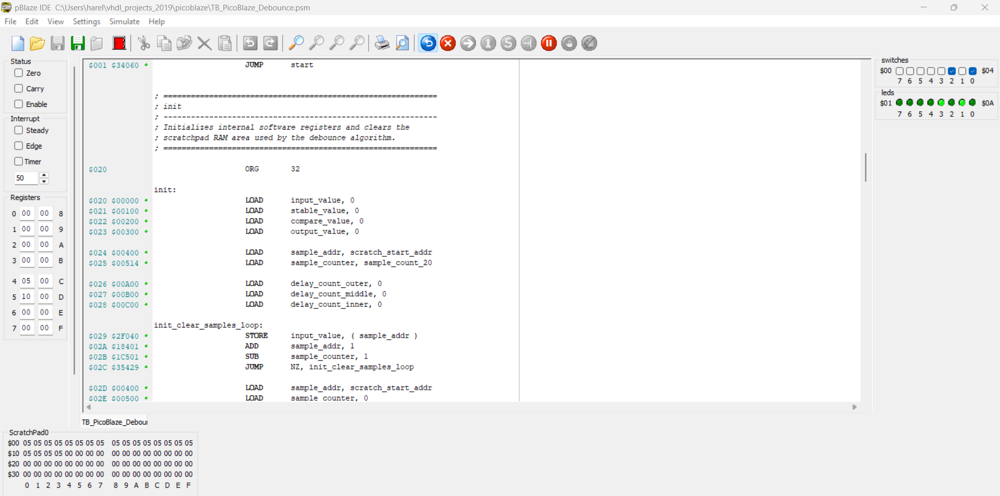
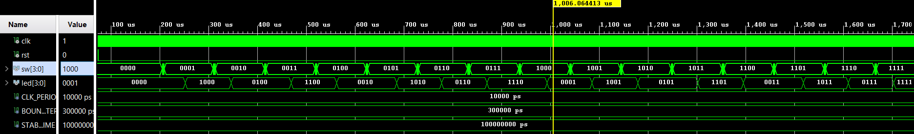

# KCPSM6 PicoBlaze Switch Debounce System

## Overview

This project implements a switch debounce system on the Basys3 FPGA board using the **KCPSM6 PicoBlaze soft processor**.

The system reads a 4-bit input from the physical board switches, performs a software debounce algorithm in PicoBlaze assembly, reverses the bit order, and outputs the result to four physical LEDs.

The project demonstrates a complete FPGA hardware/software co-design workflow: writing PicoBlaze assembly firmware, generating VHDL program memory from `.psm` files, integrating the KCPSM6 core into a VHDL top-level design, implementing register-based hardware interfacing through PicoBlaze `INPUT` and `OUTPUT` port decoding, verifying the behavior through Vivado behavioral simulation and waveform analysis, and preparing the design for Basys3 hardware implementation.

## System Behavior

The system continuously samples the four physical switches on the Basys3 board.

After the input remains stable for the required debounce period, the firmware reverses the order of the four input bits and writes the result to the LEDs.

```text
Input:   sw[3:0]
Output:  led[3:0]
```

The bit reversal is:

| Switch Input | LED Output |
|---|---|
| `sw[0]` | `led[3]` |
| `sw[1]` | `led[2]` |
| `sw[2]` | `led[1]` |
| `sw[3]` | `led[0]` |

Example:

```text
sw[3:0]  = 0001
led[3:0] = 1000
```

## Target Hardware and Tools

| Category | Details |
|---|---|
| FPGA Board | Digilent Basys3 |
| FPGA Device | Xilinx / AMD Artix-7 |
| Clock | 100 MHz |
| Soft Processor | KCPSM6 PicoBlaze |
| Firmware Language | PicoBlaze Assembly |
| Hardware Description Language | VHDL |
| FPGA Tool | Xilinx Vivado |
| Firmware Tools | pBlazIDE, KCPSM6 Assembler |
| Inputs | 4 physical switches |
| Outputs | 4 physical LEDs |

## Hardware Architecture and HDL Components

The hardware system is built around the **KCPSM6 PicoBlaze** and a generated VHDL program memory ROM.

<p align="center">
  
</p>

The schematic above shows the RTL-level connection between the main design components.

### `top.vhd`

`top.vhd` is the top-level wrapper of the FPGA design.

It connects the external Basys3 signals to the internal PicoBlaze-based system:

```vhdl
clk : in std_logic;
rst : in std_logic;
sw  : in  std_logic_vector(3 downto 0);
led : out std_logic_vector(3 downto 0);
```

Inside this file, the design instantiates the PicoBlaze processor, the generated program memory, the switch register, and the LED register.

It also contains the VHDL logic that connects PicoBlaze logical I/O ports to the hardware interface:

| PicoBlaze Port | Direction | Connected Hardware |
|---|---|---|
| `0x00` | Input | Registered switch value |
| `0x01` | Output | LED register |

The PicoBlaze processor does not connect directly to the Basys3 switches and LEDs. `top.vhd` defines the complete hardware system around the processor.

---
### `kcpsm6.vhd`

`kcpsm6.vhd` is the KCPSM6 PicoBlaze processor core.

This is the soft-core processor that executes the PicoBlaze assembly firmware.  
In this project, the firmware performs the debounce algorithm, checks that the switch input is stable, reverses the lower four bits, and writes the result to the output port.

The processor communicates with the rest of the design through:

| Signal | Purpose |
|---|---|
| `address` | Selects the next instruction address in program memory |
| `instruction` | Carries the instruction from program memory back to PicoBlaze |
| `bram_enable` | Enables the program memory during instruction fetch |
| `in_port` | Carries input data into PicoBlaze |
| `out_port` | Carries output data from PicoBlaze |
| `port_id` | Selects the logical I/O port |
| `write_strobe` | Indicates a valid output write cycle |

---

### `PicoBlaze_Debounce.vhd`

`PicoBlaze_Debounce.vhd` is the program memory of the PicoBlaze system.

This file contains the actual machine instructions that the KCPSM6 processor runs.  

It was generated from the PicoBlaze assembly source file using the KCPSM6 assembler.

The original firmware is written in a human-readable `.psm` assembly file, but the FPGA design uses the generated VHDL ROM version:

```text
PicoBlaze_Debounce.psm
        +
ROM_form.vhd
        |
        v
kcpsm6.exe
        |
        v
PicoBlaze_Debounce.vhd
```

During operation, the PicoBlaze processor sends an instruction address to this memory through `address`.  
The program memory returns the matching 18-bit instruction through `instruction`.  
The `bram_enable` signal enables the memory access, and `clk` synchronizes the ROM with the rest of the system.

---

### `PicoBlaze_Debounce_tst.vhd`

`PicoBlaze_Debounce_tst.vhd` is a simulation version of the generated program memory.

Both `PicoBlaze_Debounce.vhd` and `PicoBlaze_Debounce_tst.vhd` are generated VHDL ROM files created from the PicoBlaze assembly firmware. They implement the same debounce logic, but `PicoBlaze_Debounce_tst.vhd` uses a shorter delay value to avoid waiting for the full hardware debounce timing during simulation.

| Program Memory File | Purpose | Delay Setting |
|---|---|---|
| `PicoBlaze_Debounce.vhd` | Hardware implementation | Uses the larger hardware delay value, `theDelay = 0x64`, which is approximately 40 ms per delay-loop interval |
| `PicoBlaze_Debounce_tst.vhd` | Fast Vivado simulation | Uses the smaller simulation delay value, `theDelay = 0x02`, which is approximately 320 ns per delay-loop interval  |

For hardware implementation, use:

```vhdl
program_memory_inst : entity work.PicoBlaze_Debounce
```

For fast simulation, use:

```vhdl
program_memory_inst : entity work.PicoBlaze_Debounce_tst
```

The delay value is not changed inside Vivado directly.  
To change the debounce timing, the PicoBlaze assembly firmware must be edited and the VHDL program memory must be regenerated.

---

### `switch_register_inst`

`switch_register_inst` is an instance of the generic `REG.vhd` module that samples and stores the physical switch inputs.

```text
sw[3:0]  ->  switch_register_inst  ->  switch_reg_value
```

Its purpose is to provide the PicoBlaze processor with a stable, clock-synchronized, and modular interface to the external switches. By registering the input values, the design separates the physical board signals from the internal logic and ensures that the processor always reads a synchronized value.

When PicoBlaze performs an `INPUT` operation from port `0x00`, `top.vhd` places the registered switch value on `in_port`:

```vhdl
when X"00" =>
    in_port <= "0000" & switch_reg_value;
```

The upper four bits are filled with zeros because PicoBlaze uses 8-bit I/O ports, while this project uses only four switch inputs.

---

### `led_register_inst`

`led_register_inst` is another instance of the generic `REG.vhd` register module.

It stores the lower four bits written by PicoBlaze and drives the physical LEDs.

```text
out_port[3:0]  ->  led_register_inst  ->  led[3:0]
```

This register is needed because `out_port` is only valid during a PicoBlaze output operation.  
The LEDs must keep displaying the last valid output value after the `OUTPUT` instruction has finished.

The LED register updates only when PicoBlaze writes to output port `0x01` and `write_strobe` is active:

```vhdl
led_write_enable <= '1' when (port_id = X"01" and write_strobe = '1') else '0';
```

This prevents the LEDs from changing when PicoBlaze is not performing a valid write to the LED port.

<p align="center">
  
</p>

The timing diagram illustrates the relationship between `port_id`, `out_port`, and `write_strobe` during a PicoBlaze `OUTPUT` instruction.

While `out_port` carries the data being written, `write_strobe` generates a one-clock pulse indicating that the data is valid and should be captured. In this project, the LED register updates only when `write_strobe` is asserted **and** `port_id` equals `0x01`, ensuring that only valid writes intended for the LED output are stored.

---

### System Operation Summary

The complete operation is:

```text
1. The Basys3 switches enter the FPGA through sw[3:0].
2. switch_register_inst samples the switch value.
3. PicoBlaze reads the registered switch value through input port 0x00.
4. The firmware performs debounce and bit reversal.
5. PicoBlaze writes the result to output port 0x01.
6. led_register_inst stores out_port[3:0] only during a valid write_strobe.
7. The Basys3 LEDs display the stored result.
```

## Development Flow

The project was developed using the following flow:


## PicoBlaze Firmware

The debounce algorithm is implemented in PicoBlaze assembly.

The firmware defines two I/O ports:

```asm
CONSTANT port_in,  00
CONSTANT port_out, 01
```
The firmware implements debounce using repeated sampling, delay loops, and sample comparison.

The debounce timing is controlled by the `theDelay` firmware constant. This makes the delay easy to adjust for either fast simulation or real hardware operation.

For each debounce check, the firmware collects **20 consecutive switch samples** and stores them in PicoBlaze scratchpad memory. The first sample is used as the reference value, and the remaining **19 samples** are compared against it.

If all samples are equal, the input is accepted as a stable debounced value. If any sample is different, the debounce process restarts and a new set of samples is collected.

After a stable input value is accepted, the firmware reverses the lower four bits and writes the result to output port `0x01`.

## pBlazIDE Firmware Verification

Before integrating the firmware into Vivado, the PicoBlaze assembly code was imported into **pBlazIDE** for testing and verification.

The pBlazIDE test file used for this verification is stored in:

```text
firmware/TB_PicoBlaze_Debounce.psm
```

To simulate the hardware interface, the following definitions were added:

| Definition | Meaning |
|---|---|
| `switches DSIN 0` | Simulated switches are connected to input port `0` |
| `leds DSOUT 1` | Simulated LEDs are connected to output port `1` |

These definitions create virtual input and output devices inside pBlazIDE, allowing the firmware to be tested using the same logical port numbers that are later used in the FPGA implementation.

<p align="center">
  
</p>

## Vivado Simulation

A VHDL testbench was created to verify the top-level system behavior in Vivado.

The testbench applies all possible 4-bit switch combinations from `0000` to `1111`.  
Before each stable input value, the testbench also applies fast-changing switch transitions to emulate mechanical switch bouncing.

This verifies that the PicoBlaze firmware does not immediately accept unstable input changes. Instead, it waits until the sampled switch value remains stable before updating the LED output.

<p align="center">
  
</p>

The waveform verifies:

- Fast-changing switch input transitions are applied before stable values
- The debounce firmware waits for a stable input before accepting the value
- The final LED output matches the bit-reversed switch input
- All 16 possible 4-bit input combinations are tested

## PicoBlaze Microcontroller vs Pure FPGA Logic

This debounce task could be implemented entirely in VHDL, but PicoBlaze provides a useful hardware/software design tradeoff.

| Category | KCPSM6 PicoBlaze | Pure FPGA Logic |
|---|---|---|
| Control Flow | Easy to describe sequential algorithms | Requires explicit FSM and control logic |
| Resource Behavior | Resource requirements remain constant with increasing complexity | Logic resources grow with increasing complexity |
| Best Use Case | Control, sequencing, debounce, simple embedded tasks | High-speed datapaths and parallel processing |
| Execution Model | Sequential instruction execution | Fully parallel hardware execution |
| Design Tradeoff | Simpler development with lower performance | Higher performance with increased design complexity |

In this project, debounce is a good fit for PicoBlaze because it is a sequential process based on repeated sampling, delays, comparisons, and controlled output updates.

## Repository Structure

```text
PicoBlaze_KCPSM6_Debounce/
│
├── README.md
├── .gitattributes
│
├── vivado_sources/
│   ├── top.vhd
│   ├── REG.vhd
│   ├── kcpsm6.vhd
│   ├── PicoBlaze_Debounce.vhd
│   └── PicoBlaze_Debounce_tst.vhd
│
├── firmware/
│   ├── PicoBlaze_Debounce.psm
│   └── TB_PicoBlaze_Debounce.psm
│
├── constraints/
│   └── Basys3.xdc
│
├── sim/
│   └── tb_top.vhd
│
├── tools/
│   ├── PicoBlaze.xml
│   ├── pBlazIDE.exe
│   ├── kcpsm6.exe
│   └── ROM_form.vhd
│
└── docs/
    └── images/
        ├── kcpsm6_block_diagram.png
        ├── kcpsm6_write_timing.png
        ├── pblazide_test.png
        ├── vivado_rtl_schematic.png
        └── vivado_simulation_waveform.png
```

## How to Run in Vivado

1. Open Vivado.
2. Create a new RTL project.
3. Select the Basys3 board or the matching Artix-7 FPGA device.
4. Add all files from `vivado_sources/` as design sources.
5. Add `constraints/Basys3.xdc` as the constraints file.
6. Add `sim/tb_top.vhd` as a simulation source.
7. Run behavioral simulation.
8. For hardware implementation, make sure `top.vhd` instantiates `PicoBlaze_Debounce`.
9. Run synthesis.
10. Run implementation.
11. Generate the bitstream.
12. Program the Basys3 board.

## Third-Party Tools and Attribution

This repository includes several PicoBlaze-related tools and files that were used during development.

The following files were not written by the project author:

| File | Purpose |
|---|---|
| `kcpsm6.vhd` | KCPSM6 PicoBlaze processor core |
| `kcpsm6.exe` | KCPSM6 assembler |
| `pBlazIDE.exe` | PicoBlaze development and simulation environment |
| `ROM_form.vhd` | ROM template used by the assembler |
| `PicoBlaze.xml` | Notepad++ syntax highlighting file for PicoBlaze assembly |

They are included to document the development process and make the project easier to reproduce.

## Summary

This project implements a PicoBlaze-based switch debounce system, successfully demonstrating a complete Hardware/Software co-design flow on the Basys3 FPGA. By offloading the sequential debounce logic to a soft-core processor, the design maintains a simple, modular VHDL hardware architecture. 

The project covers the full development cycle: from writing assembly and generating program memory ROM, to integrating the core into Vivado, running behavioral simulations, and mapping to physical hardware. Ultimately, it highlights how soft-core processors can be effectively used inside FPGA logic to implement practical embedded control behavior.

