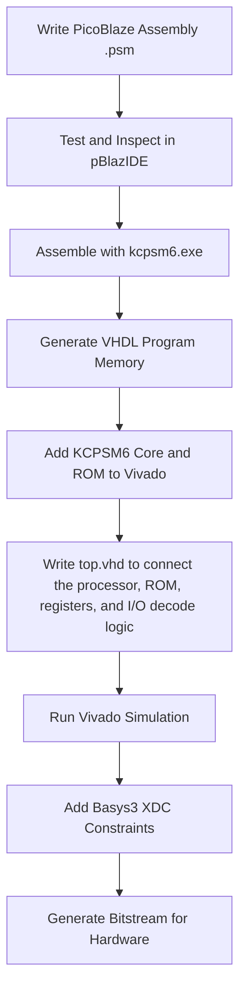

# KCPSM6 PicoBlaze Switch Debounce System

     

## Overview

This project implements a switch debounce system on the Basys3 FPGA board using the **KCPSM6 PicoBlaze soft microcontroller**.

The system reads a 4-bit input from the physical board switches, performs a software debounce algorithm in PicoBlaze assembly, reverses the bit order, and outputs the result to four physical LEDs.

The project demonstrates a complete FPGA soft-processor workflow: writing assembly firmware, generating VHDL program memory, integrating the KCPSM6 core into a VHDL top-level design, decoding PicoBlaze I/O ports, verifying the behavior in simulation, and preparing the design for Basys3 hardware implementation.

## Project Goal

The goal of this project is to demonstrate how a small soft-core processor can be used inside an FPGA to implement a practical embedded control task.

Instead of designing the debounce algorithm entirely as custom VHDL logic, the debounce process is implemented as firmware running on PicoBlaze. The surrounding VHDL logic handles the hardware interface: switch sampling, LED output storage, PicoBlaze I/O port decoding, and Basys3 pin mapping through the XDC constraints file.

This project demonstrates:

- KCPSM6 PicoBlaze soft processor integration
- PicoBlaze assembly programming
- VHDL top-level system design
- Program memory generation from `.psm` firmware
- Register-based FPGA hardware interfacing
- PicoBlaze `INPUT` and `OUTPUT` port decoding
- Vivado behavioral simulation and waveform verification

## System Behavior

The system continuously samples the four physical switches on the Basys3 board.

After the input remains stable for the required debounce period, the firmware reverses the order of the four input bits and writes the result to the LEDs.

```text
Input:   sw[3:0]
Output:  led[3:0]
```

The bit reversal is:

| Switch Input | LED Output |
|---|---|
| `sw[0]` | `led[3]` |
| `sw[1]` | `led[2]` |
| `sw[2]` | `led[1]` |
| `sw[3]` | `led[0]` |

Example:

```text
sw[3:0]  = 0001
led[3:0] = 1000
```

## Target Hardware and Tools

| Category | Details |
|---|---|
| FPGA Board | Digilent Basys3 |
| FPGA Device | Xilinx / AMD Artix-7 |
| Clock | 100 MHz |
| Soft Processor | KCPSM6 PicoBlaze |
| Firmware Language | PicoBlaze Assembly |
| Hardware Description Language | VHDL |
| FPGA Tool | Xilinx Vivado |
| Firmware Tools | pBlazIDE, KCPSM6 Assembler |
| Inputs | 4 physical switches |
| Outputs | 4 physical LEDs |

## Hardware Architecture and HDL Components

The hardware design is built from a small number of VHDL components that work together to create a complete PicoBlaze-based embedded system.

The main idea is simple: the physical switches are sampled by FPGA logic, PicoBlaze reads that value through an input port, the firmware performs debounce and bit reversal, and the result is written back to the LEDs through an output port.

<p align="center">
  
</p>

The schematic above shows the final RTL-level connection between the PicoBlaze processor, the generated program memory, the input register, the output register, and the I/O decoding logic.

## HDL Components

| Component | What It Does | Why It Is Needed |
|---|---|---|
| `top.vhd` | The top-level VHDL file of the project | Connects all parts of the system together and exposes the external FPGA ports: `clk`, `rst`, `sw`, and `led` |
| `kcpsm6.vhd` | The KCPSM6 PicoBlaze processor core | Executes the assembly firmware that performs debounce, comparison, bit reversal, and output control |
| `PicoBlaze_Debounce.vhd` | The generated VHDL program memory for hardware | Stores the assembled PicoBlaze instructions with the real hardware debounce delay |
| `PicoBlaze_Debounce_tst.vhd` | The generated VHDL program memory for simulation | Uses a shorter delay so the debounce behavior can be simulated quickly |
| `REG.vhd` | A generic clocked register module | Used to store stable hardware values on the rising edge of the clock |
| `switch_register_inst` | Instance of `REG.vhd` | Samples the physical switch input before PicoBlaze reads it |
| `led_register_inst` | Instance of `REG.vhd` | Stores the last valid PicoBlaze output and keeps the LEDs stable |
| Input port logic | Combinational VHDL logic inside `top.vhd` | Places the switch register value on `in_port` when PicoBlaze reads from port `0x00` |
| Output port logic | Combinational VHDL logic inside `top.vhd` | Enables the LED register only when PicoBlaze writes to port `0x01` |
| `tb_top.vhd` | VHDL testbench | Simulates the top-level design and verifies the expected switch-to-LED behavior |
| `Basys3.xdc` | Vivado constraints file | Maps the top-level VHDL ports to the physical Basys3 pins |

## How the Components Work Together

The system has three main paths: the program execution path, the input path, and the output path.

### 1. Program Execution Path

The PicoBlaze processor does not execute the `.psm` assembly file directly.  
The assembly file is first converted into a VHDL program memory file.

```text
PicoBlaze_Debounce.psm
        |
        v
KCPSM6 assembler
        |
        v
PicoBlaze_Debounce.vhd
```

In the VHDL system, PicoBlaze fetches instructions from this generated program memory.

```text
KCPSM6 processor
      |
      | address[11:0]
      v
Program Memory ROM
      |
      | instruction[17:0]
      v
KCPSM6 processor
```

The main signals between the processor and the program memory are:

| Signal | Purpose |
|---|---|
| `address` | The instruction address requested by PicoBlaze |
| `instruction` | The 18-bit instruction returned from the program memory |
| `bram_enable` | Enables the program memory during instruction fetch |
| `clk` | Synchronizes the processor and program memory |

This is the connection used in `top.vhd`:

```vhdl
program_memory_inst : entity work.PicoBlaze_Debounce
    port map (
        address     => address,
        instruction => instruction,
        enable      => bram_enable,
        clk         => clk
    );
```

### 2. Switch Input Path

The physical switches enter the FPGA through the top-level port:

```vhdl
sw : in std_logic_vector(3 downto 0)
```

The switch values are first sampled into a clocked register.

```text
Basys3 switches
      |
      v
switch_register_inst
      |
      v
switch_reg_value
```

PicoBlaze reads external data through the 8-bit signal `in_port`.  
Since this project uses only four switches, the switch value is placed in the lower four bits and the upper four bits are filled with zeros.

```vhdl
process(port_id, switch_reg_value)
begin
    case port_id is

        when X"00" =>
            in_port <= "0000" & switch_reg_value;

        when others =>
            in_port <= (others => '0');

    end case;
end process;
```

This means:

| PicoBlaze Action | VHDL Response |
|---|---|
| `INPUT` from port `0x00` | `in_port` receives `0000 & switch_reg_value` |
| `INPUT` from any other port | `in_port` receives `00000000` |

The firmware defines the input port as:

```asm
CONSTANT port_in, 00
```

So when the firmware executes an `INPUT` instruction from `port_in`, it reads the registered switch value.

### 3. PicoBlaze Firmware Processing

After reading the switch value, the PicoBlaze firmware performs the main algorithm:

1. Samples the switch value multiple times.
2. Waits between samples using a delay loop.
3. Compares the collected samples.
4. Accepts the value only if all samples are equal.
5. Reverses the lower four bits.
6. Writes the result to the LED output port.

This part is done in software, inside the PicoBlaze assembly firmware.

### 4. LED Output Path

PicoBlaze writes external data through the 8-bit signal `out_port`.

The firmware defines the LED output port as:

```asm
CONSTANT port_out, 01
```

When the firmware executes an `OUTPUT` instruction to port `0x01`, PicoBlaze places:

- The target port number on `port_id`
- The output value on `out_port`
- A one-clock write pulse on `write_strobe`

The VHDL logic checks that PicoBlaze is writing to the LED port and that the output data is valid.

```vhdl
led_write_enable <= '1' when (port_id = X"01" and write_strobe = '1') else '0';
```

Only then does the LED register update.

```text
PicoBlaze out_port
      |
      v
LED write-enable logic
      |
      v
led_register_inst
      |
      v
Basys3 LEDs
```

The LED register stores only the lower four bits of `out_port`.

```vhdl
d => out_port(3 downto 0)
```

The LEDs are not connected directly to `out_port` because `out_port` is a shared PicoBlaze output bus.  
The `write_strobe` signal confirms when the value on `out_port` is valid and should be stored.

<p align="center">
  
</p>

## Full System Flow

The complete system works as follows:

```text
1. The Basys3 switches are sampled into switch_register_inst.
2. PicoBlaze reads the registered switch value from input port 0x00.
3. The firmware runs the debounce algorithm.
4. If the input is stable, the firmware reverses the lower four bits.
5. PicoBlaze writes the result to output port 0x01.
6. The VHDL output logic detects port 0x01 and write_strobe.
7. led_register_inst stores out_port[3:0].
8. The Basys3 LEDs display the final result.
```

This structure separates the system into clear hardware and software responsibilities:

| Part | Responsibility |
|---|---|
| PicoBlaze firmware | Debounce algorithm, sample comparison, bit reversal, output decision |
| VHDL logic | Hardware interfacing, register storage, I/O port decoding |
| XDC constraints | Physical mapping to Basys3 board pins |

## Development Flow

The project was developed using the following flow:



## PicoBlaze Firmware

The debounce algorithm is implemented in PicoBlaze assembly.

The firmware defines two I/O ports:

```asm
CONSTANT port_in,  00
CONSTANT port_out, 01
```

| Port | Direction | Purpose |
|---|---|---|
| `0x00` | Input | Read switch value |
| `0x01` | Output | Write LED value |

The firmware performs the following sequence:

1. Initialize internal PicoBlaze registers.
2. Read the switch value from input port `0x00`.
3. Store multiple switch samples in scratchpad memory.
4. Wait between samples using a delay loop.
5. Compare all collected samples.
6. Accept the value only if all samples are equal.
7. Reverse the lower four bits.
8. Write the result to output port `0x01`.

This approach filters mechanical switch bouncing by requiring the input value to remain stable across multiple consecutive samples.

## pBlazIDE Firmware Verification

Before integrating the firmware into Vivado, the PicoBlaze assembly code was tested and inspected using pBlazIDE.

The pBlazIDE test version uses simulated input and output definitions:

```asm
switches    DSIN  0
leds        DSOUT 1
```

These definitions connect simulated devices to the same port numbers used by the firmware.

| Definition | Meaning |
|---|---|
| `switches DSIN 0` | Simulated switches are connected to input port `0` |
| `leds DSOUT 1` | Simulated LEDs are connected to output port `1` |

These definitions are used only for pBlazIDE verification.  
The actual FPGA hardware mapping is implemented in `top.vhd`.

<p align="center">
  
</p>

## Program Memory Generation

The `.psm` assembly file is not directly executed by Vivado.

The KCPSM6 assembler converts the PicoBlaze assembly program into a VHDL program memory file. The assembler uses `ROM_form.vhd` as a template.

```text
PicoBlaze_Debounce.psm
        +
ROM_form.vhd
        |
        v
kcpsm6.exe
        |
        v
PicoBlaze_Debounce.vhd
```

The generated VHDL file is added to Vivado as a design source and instantiated in `top.vhd` as the program memory ROM.

## Vivado Simulation

A VHDL testbench was created to verify the top-level system behavior.

The testbench applies all possible 4-bit switch combinations from `0000` to `1111`. For each input value, the expected LED output is the bit-reversed version of the switch input.

<p align="center">
  
</p>

The waveform verifies:

- Correct PicoBlaze program execution
- Correct switch input sampling
- Correct output port write behavior
- Correct LED register update
- Correct bit-reversal result for all input combinations

## Basys3 Constraints

The physical Basys3 board connections are defined in `Basys3.xdc`.

| Top-Level Signal | Basys3 Resource |
|---|---|
| `clk` | 100 MHz onboard clock |
| `rst` | Push button reset |
| `sw[3:0]` | First four physical switches |
| `led[3:0]` | First four physical LEDs |

The 100 MHz clock is constrained using:

```tcl
create_clock -period 10.000 -name clk100 [get_ports clk]
```

This allows Vivado to perform timing analysis using the correct clock period.

## Simulation Version vs Hardware Version

Two generated program memory files are included:

| File | Purpose |
|---|---|
| `PicoBlaze_Debounce.vhd` | Hardware version with a longer debounce delay |
| `PicoBlaze_Debounce_tst.vhd` | Simulation version with a shorter delay |

The simulation version exists because a real debounce delay would make behavioral simulation unnecessarily long.

For hardware implementation, use:

```vhdl
program_memory_inst : entity work.PicoBlaze_Debounce
```

For fast simulation, use:

```vhdl
program_memory_inst : entity work.PicoBlaze_Debounce_tst
```

## PicoBlaze Microcontroller vs Pure FPGA Logic

This debounce task could be implemented entirely in VHDL, but PicoBlaze provides a useful hardware/software design tradeoff.

| Category | KCPSM6 PicoBlaze | Pure FPGA Logic |
|---|---|---|
| Control Flow | Easy to describe sequential algorithms | Requires explicit FSM design |
| Flexibility | Firmware can be modified more easily | HDL logic must be redesigned |
| Resource Behavior | Logic usage remains mostly fixed as firmware grows | Logic usage grows with implementation complexity |
| Performance | Sequential instruction execution | Fully parallel hardware execution |
| Best Use Case | Control, sequencing, debounce, simple embedded tasks | High-speed datapaths and parallel processing |
| Design Tradeoff | Lower performance, simpler control design | Higher performance, more manual hardware design |

In this project, debounce is a good fit for PicoBlaze because it is a sequential process based on repeated sampling, delays, comparisons, and controlled output updates.

## Repository Structure

```text
KCPSM6-Switch-Debounce-Basys3/
│
├── README.md
├── .gitignore
│
├── vivado_sources/
│   ├── top.vhd
│   ├── REG.vhd
│   ├── kcpsm6.vhd
│   ├── PicoBlaze_Debounce.vhd
│   └── PicoBlaze_Debounce_tst.vhd
│
├── firmware/
│   ├── PicoBlaze_Debounce.psm
│   └── TB_PicoBlaze_Debounce.psm
│
├── constraints/
│   └── Basys3.xdc
│
├── sim/
│   └── tb_top.vhd
│
├── tools/
│   ├── PicoBlaze.xml
│   ├── pBlazIDE.exe
│   ├── kcpsm6.exe
│   └── ROM_form.vhd
│
└── docs/
    └── images/
        ├── vivado_rtl_schematic.png
        ├── kcpsm6_write_timing.png
        ├── vivado_simulation_waveform.png
        └── pblazide_test.png
```

## How to Run in Vivado

1. Open Vivado.
2. Create a new RTL project.
3. Select the Basys3 board or the matching Artix-7 FPGA device.
4. Add all files from `vivado_sources/` as design sources.
5. Add `constraints/Basys3.xdc` as the constraints file.
6. Add `sim/tb_top.vhd` as a simulation source.
7. Run behavioral simulation.
8. For hardware implementation, make sure `top.vhd` instantiates `PicoBlaze_Debounce`.
9. Run synthesis.
10. Run implementation.
11. Generate the bitstream.
12. Program the Basys3 board.

## How to Regenerate the Program Memory

To regenerate the VHDL program memory from the PicoBlaze assembly file:

1. Edit the `.psm` firmware file.
2. Run the KCPSM6 assembler.
3. Use `ROM_form.vhd` as the ROM template.
4. Add the generated `.vhd` file to Vivado.

For fast simulation, the debounce delay can be reduced before assembling, and the generated file can be used as `PicoBlaze_Debounce_tst.vhd`.

## Third-Party Tools and Attribution

This repository includes several PicoBlaze-related tools and files that were used during development.

The following files were not written by the project author:

| File | Purpose |
|---|---|
| `kcpsm6.vhd` | KCPSM6 PicoBlaze processor core |
| `kcpsm6.exe` | KCPSM6 assembler |
| `pBlazIDE.exe` | PicoBlaze development and simulation environment |
| `ROM_form.vhd` | ROM template used by the assembler |
| `PicoBlaze.xml` | Notepad++ syntax highlighting file for PicoBlaze assembly |

They are included to document the development process and make the project easier to reproduce.

Before redistributing third-party tools publicly, their original licensing terms should be reviewed.

## Skills Demonstrated

This project demonstrates practical experience with:

- FPGA design using VHDL
- Soft-core microcontroller integration
- PicoBlaze assembly programming
- Program memory generation
- Register-based hardware interfacing
- PicoBlaze I/O port decoding
- Vivado simulation and waveform analysis
- XDC constraint mapping for Basys3
- Hardware/software co-design inside an FPGA

## Author

**Harel Hillman**

Electrical Engineering Student  
Focus areas: FPGA Design, VHDL, Embedded Systems, and Computer Engineering

## Summary

This project implements a complete PicoBlaze-based switch debounce system on the Basys3 FPGA board.

The debounce algorithm is implemented in PicoBlaze assembly, while the physical switch and LED interfaces are implemented in VHDL. The project shows the full development flow from firmware writing, to program memory generation, to VHDL integration, simulation, and hardware mapping.

It demonstrates how a soft microcontroller can be used inside FPGA logic to implement practical embedded control behavior.
