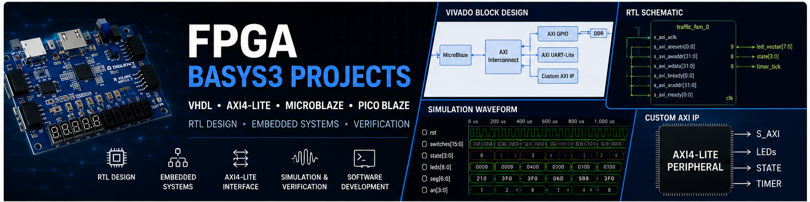
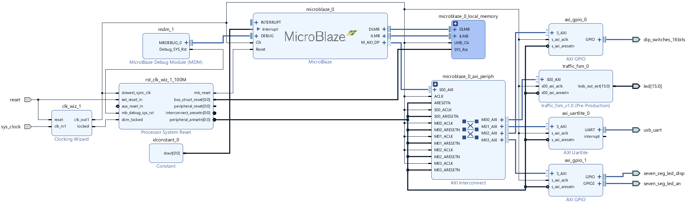
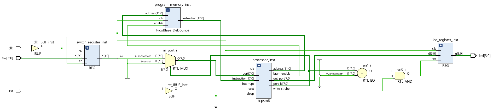
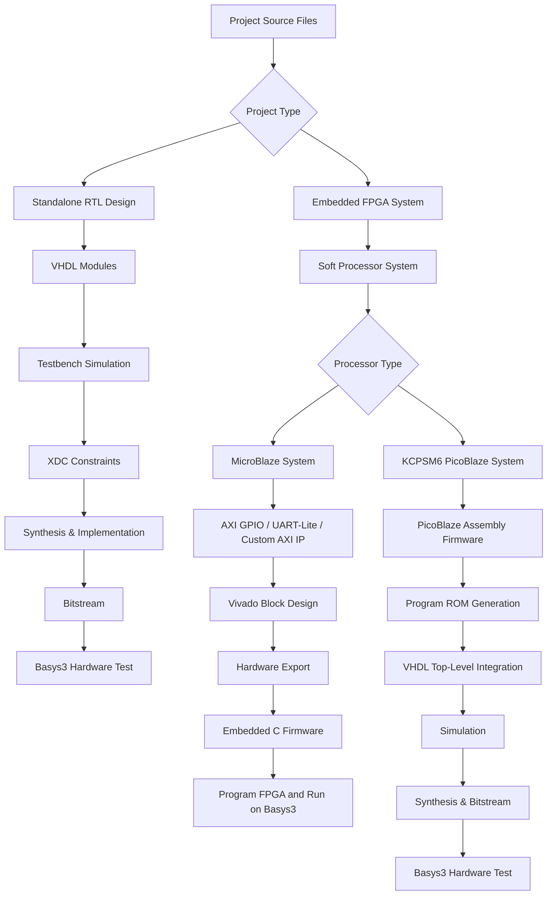

# FPGA Basys3 VHDL Projects

<p align="center">
  
</p>

<p align="center">
  
  
  
  
  
</p>

<p align="center">
<b>RTL Design · Soft Processor Systems · Custom AXI IP · Hardware/Software Co-Design · Simulation & Verification</b>
</p>

---

## Overview

This repository contains a collection of FPGA projects developed for the **Digilent Basys3** development board, based on the **Xilinx Artix-7** FPGA.

The projects move from standalone RTL designs to complete embedded FPGA systems using **MicroBlaze**, **KCPSM6 PicoBlaze**, custom **AXI4-Lite** peripherals, board-level I/O, firmware, and simulation testbenches.

Each project is self-contained and includes its own source files, constraints, simulation material, implementation notes, diagrams, and README documentation.

---

## Featured Projects

<table>
<tr>
<td width="38%">
  
</td>
<td width="62%">

### [MicroBlaze AXI Custom IP Traffic Light Controller](./MicroBlaze_AXI_Custom_IP_Traffic_Light_Controller)

Hardware/software co-design built around a custom **AXI4-Lite traffic-light controller IP**.  
The traffic decision logic runs in VHDL hardware as an FSM with hardware timers, while the MicroBlaze processor handles monitoring, switch input forwarding, UART status output, and seven-segment display control.

**Main areas:** `MicroBlaze` · `AXI4-Lite` · `Custom IP` · `VHDL FSM` · `Embedded C` · `Hardware Timers`

</td>
</tr>
</table>

<table>
<tr>
<td width="38%">
  
</td>
<td width="62%">

### [MicroBlaze Calculator System](./MicroBlaze_Calculator_System)

Bare metal calculator system running on a **MicroBlaze soft processor**.  
The system combines UART-Lite input, AXI GPIO peripherals, push-button operation selection, switch-based mode control, LEDs, and seven-segment display output.

**Main areas:** `MicroBlaze` · `Bare-Metal C` · `AXI GPIO` · `UART-Lite` · `7-Segment Display` · `State Machines`

</td>
</tr>
</table>

<table>
<tr>
<td width="38%">
  
</td>
<td width="62%">

### [KCPSM6 PicoBlaze Switch Debounce System](./PicoBlaze_KCPSM6_Debounce)

Switch debounce system implemented using the **KCPSM6 PicoBlaze** soft processor.  
The debounce algorithm runs as PicoBlaze assembly firmware, while the surrounding VHDL system handles program memory integration, I/O port decoding, switch sampling, and LED output storage.

**Main areas:** `PicoBlaze` · `Assembly` · `VHDL` · `I/O Port Decoding` · `Program Memory ROM` · `Simulation`

</td>
</tr>
</table>

<table>
<tr>
<td width="38%">
  
</td>
<td width="62%">

### [3-Digit Multiplexed 7-Segment Counter](./3_Digit_Decimal_Counter)

Modular VHDL counter system for the Basys3 seven segment display.  
The design includes clock division, cascaded decimal counters, display refresh logic, digit selection, segment decoding, terminal count detection, and testbenches for both full system and component level verification.

**Main areas:** `VHDL` · `RTL Design` · `Counters` · `Clock Division` · `Display Multiplexing` · `Testbenches`

</td>
</tr>
</table>

---

## Engineering Scope

<table>
<tr>
<td align="center" width="20%"><b>RTL Design</b><br>VHDL modules, counters, FSMs, timers, display logic</td>
<td align="center" width="20%"><b>Embedded Systems</b><br>MicroBlaze and PicoBlaze based FPGA systems</td>
<td align="center" width="20%"><b>Custom IP</b><br>AXI4-Lite peripheral design and register mapping</td>
<td align="center" width="20%"><b>Firmware</b><br>Bare metal C and PicoBlaze assembly</td>
<td align="center" width="20%"><b>Verification</b><br>Vivado behavioral simulation and VHDL testbenches</td>
</tr>
</table>

---

## Development Flow



---

## Development Environment

| Category | Tools / Technologies |
|---|---|
| FPGA Board | Digilent Basys3 |
| FPGA Device | Xilinx Artix-7 |
| HDL | VHDL |
| FPGA Toolchain | Xilinx Vivado |
| Embedded Toolchain | Xilinx SDK, KCPSM6 tools, pBlazIDE |
| Soft Processors | MicroBlaze, KCPSM6 PicoBlaze |
| Firmware | Embedded C, PicoBlaze Assembly |
| Interfaces | AXI4-Lite, AXI GPIO, UART-Lite, PicoBlaze I/O Ports |
| Board I/O | Switches, Push Buttons, LEDs, Seven-Segment Display, UART |
| Verification | Vivado Behavioral Simulation, VHDL Testbenches |

---
## Repository Structure

```text
FPGA_Basys3_VHDL_Projects/
│
├── README.md
│
├── docs/
│
├── MicroBlaze_AXI_Custom_IP_Traffic_Light_Controller/
│   ├── DOCS/
│   ├── SDK_code/
│   ├── constrs/
│   ├── traffic_fsm_IP/
│   └── README.md
│
├── MicroBlaze_Calculator_System/
│   ├── docs/
│   ├── src/
│   └── README.md
│
├── PicoBlaze_KCPSM6_Debounce/
│   ├── vivado_sources/
│   ├── firmware/
│   ├── constraints/
│   ├── sim/
│   ├── tools/
│   ├── docs/
│   └── README.md
│
└── 3_Digit_Decimal_Counter/
    ├── src/
    ├── sim/
    ├── constraints/
    ├── images/
    └── README.md
```


---

## Author

**Harel Hillman**

FPGA & Embedded Systems Engineer specializing in VHDL, custom AXI IP development, hardware/software co design, and bare metal embedded firmware.

<p align="center">
  <b>Designed, implemented, simulated, and verified on Digilent Basys3 using Xilinx Vivado.</b>
</p>
