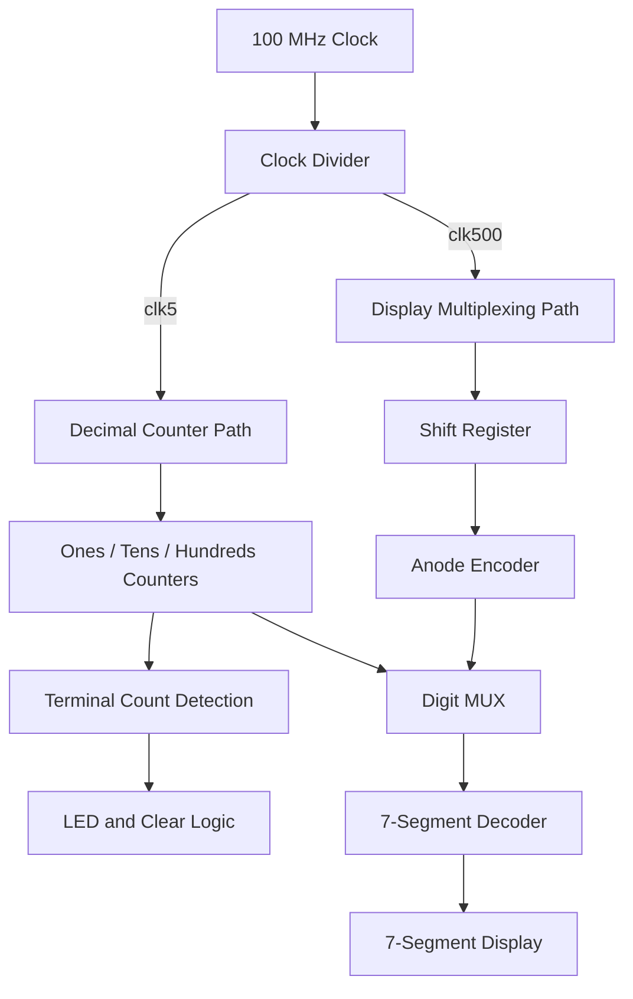

# 3-Digit Multiplexed 7-Segment Counter

   

## Overview

This project implements a modular 3-digit decimal counter system on the Digilent Basys3 FPGA board using VHDL.

The system counts from `000` up to a user-selected terminal value `NNN`, where `N` is selected using the onboard switches. The current count is displayed on three multiplexed 7-segment digits, and an LED is asserted when the selected terminal count is reached.

The design is organized as a complete FPGA digital system with separate modules for clock division, decimal counting, display refresh, digit selection, 7-segment decoding, and top-level control logic.

## Project Goal

The goal of this project is to build a clean FPGA-based counter and display system using modular VHDL design.

The project includes:

- Modular VHDL hardware architecture
- Three-digit cascaded decimal counting
- Parameterized clock division
- Dynamic 7-segment display multiplexing
- Active-low anode and segment control
- User-selectable terminal count using switches
- LED terminal-count indication
- Top-level and component-level simulation
- Basys3 hardware pin mapping using an XDC constraints file

## System Behavior

The `top_count` input is a 4-bit switch controlled value representing the decimal digit `N`.

Valid range:

```text
0000 to 1001
```

Decimal equivalent:

```text
0 to 9
```

The counter sequence is:

```text
000 → 001 → 002 → ... → NNN → 000
```

Examples:

| `top_count` | Decimal N | Counter Range |
|---|---:|---|
| `0001` | 1 | `000 → 001 → ... → 111 → 000` |
| `0010` | 2 | `000 → 001 → ... → 222 → 000` |
| `0101` | 5 | `000 → 001 → ... → 555 → 000` |
| `1001` | 9 | `000 → 001 → ... → 999 → 000` |

When all three digits match the selected value `N`, the LED is asserted. On the next count cycle, the counter clears back to `000`.

If `top_count` is set above 9, the system continues operating as a decimal counter, but the terminal-count LED is not asserted because values above 9 cannot be reached by a single decimal digit.

## Hardware Architecture

The FPGA system includes:

| Module / Signal | Purpose |
|---|---|
| `main.vhd` | Top-level module connecting all components and control logic |
| `divider.vhd` | Generates the internal 5 Hz and 500 Hz timing signals |
| `counter.vhd` | Reusable single-digit decimal counter |
| `Shift_REG.vhd` | Rotates the active-low anode pattern for display multiplexing |
| `anode_encoder.vhd` | Converts the active anode pattern into a MUX select signal |
| `mux4x1.vhd` | Selects which digit is currently sent to the 7-segment decoder |
| `Seg_decoder.vhd` | Converts a decimal digit into an active-low 7-segment pattern |
| `Basys3.xdc` | Maps the top-level ports to the Basys3 FPGA pins |

## Hardware Platform

| Item | Description |
|---|---|
| FPGA Board | Digilent Basys3 |
| FPGA Family | Xilinx Artix-7 |
| HDL | VHDL |
| Toolchain | Xilinx Vivado |
| Input Clock | 100 MHz |
| User Input | 4 onboard switches |
| Reset Input | Onboard push button |
| Display Output | 3 digits of the onboard 7-segment display |
| Status Output | Onboard LED |

## System Architecture

<p align="center">
  
</p>

The system is divided into two main paths:

| Path | Purpose |
|---|---|
| Counter Path | Generates the current 3-digit decimal count |
| Display Path | Selects and drives the active 7-segment digit |

The counter path runs at a slow visible rate, while the display path refreshes faster to create a stable multiplexed display.

## Component Structure

| Component | Main Role | Design Notes |
|---|---|---|
| `main` | Top-level integration | Connects all modules, controls counter clearing, LED output, and disables the unused fourth display digit |
| `divider` | Clock generation | Divides the 100 MHz clock into `clk5` for counting and `clk500` for display refresh |
| `counter` | Decimal digit counter | Counts from 0 to 9 and outputs status flags for carry and terminal-count detection |
| `Shift_REG` | Anode rotation | Generates the rotating active-low pattern `110 → 101 → 011` |
| `anode_encoder` | Digit selection encoding | Converts the active anode value into a 2-bit MUX selector |
| `mux4x1` | Digit routing | Selects between ones, tens, and hundreds digits |
| `Seg_decoder` | Display decoding | Converts a decimal digit into the required active-low 7-segment output pattern |

## Clocking

The clock divider receives the 100 MHz Basys3 clock and generates two internal clocks:

| Signal | Frequency | Purpose |
|---|---:|---|
| `clk5` | 5 Hz | Counter update rate |
| `clk500` | 500 Hz | Display multiplexing refresh rate |

The divider uses generic half-period cycle counts:

```vhdl
clk500Hz : integer := 100000;
clk5Hz   : integer := 10000000;
```

The output frequency is calculated as:

```text
Fout = Fin / (2 × N)
```

The divider also uses an internal `rdy_rst` signal. This signal prevents the divider from being continuously cleared while the reset input remains high. Instead, the divider restarts from a known state once and then continues running in a controlled way.

## System Flow

The system continuously updates the decimal counter and refreshes the display in parallel.



## Counter Control Logic

The three decimal counters are connected as a cascaded counting system.

| Logic | Purpose |
|---|---|
| Ones digit always enabled | Advances the least significant digit every counter clock |
| Tens enabled when ones reaches 9 | Creates decimal carry from ones to tens |
| Hundreds enabled when ones and tens reach 9 | Creates decimal carry into the hundreds digit |
| `allrchtop` detection | Detects when all three digits equal `top_count` |
| LED assertion | Turns on the LED at the selected terminal count |
| Clear logic | Returns the system to `000` after reaching `NNN` |

Key control signals:

```vhdl
en2 <= '1' when rch91 = '1' else '0';

en3 <= '1' when rch92 = '1' and rch91 = '1' else '0';

allrchtop <= toprch3 and toprch2 and toprch1;

led <= '1' when allrchtop = '1' else '0';
```

## Display Multiplexing

The Basys3 display is controlled using active-low anodes and active-low segment signals.

```text
0 = ON
1 = OFF
```

The design uses three of the four display digits. The unused fourth digit is disabled by the top-level signal:

```vhdl
a3 <= '1';
```

The display path works as follows:

```text
Shift_REG → anode_encoder → mux4x1 → Seg_decoder → seven_seg
```

At each refresh step, one anode is activated, the matching digit is selected, and the correct segment pattern is sent to the display.

## Simulation and Verification

The project includes VHDL testbenches for the full system and selected internal modules.

| Testbench | Purpose |
|---|---|
| `tb_main.vhd` | Verifies the complete integrated system |
| `tb_div.vhd` | Verifies the clock divider |
| `tb_counter.vhd` | Verifies the single-digit decimal counter |

For simulation, the divider values are reduced to avoid simulating millions of 100 MHz clock cycles.

Example from `tb_main.vhd`:

```vhdl
generic map (
    CLK500_HALF_PERIOD_CYCLES => 2,
    CLK5_HALF_PERIOD_CYCLES   => 5
)
```

With a 10 ns simulation clock period:

| Signal | Toggle Interval | Full Period |
|---|---:|---:|
| `clk500` | 20 ns | 40 ns |
| `clk5` | 50 ns | 100 ns |

These shortened values make it possible to verify the counter and display behavior quickly while preserving the same divider structure used in the hardware configuration.

## Simulation Result

<p align="center">
  
</p>

In this simulation, `top_count` is set to `1`, so the selected terminal value is:

```text
111
```

The waveform shows:

- Divided clock generation
- Counter progression up to `111`
- LED assertion at the terminal count
- Counter clearing back to `000`
- Continuous anode rotation for display multiplexing
- Correct coordination between digit selection and 7-segment output updates

## FPGA Pin Mapping

The `Basys3.xdc` file maps the top-level VHDL ports to the physical Basys3 board pins.

| Top-Level Signal | Basys3 Peripheral |
|---|---|
| `clk_100M` | 100 MHz onboard clock |
| `reset` | Push button |
| `top_count[3:0]` | Switches SW0–SW3 |
| `seven_seg[6:0]` | 7-segment cathode signals |
| `anode[2:0]` | Three active display anodes |
| `a3` | Disabled fourth anode |
| `led` | Onboard LED |

## Repository Structure

```text
.
├── README.md
├── src/
│   ├── main.vhd
│   ├── divider.vhd
│   ├── counter.vhd
│   ├── Shift_REG.vhd
│   ├── anode_encoder.vhd
│   ├── mux4x1.vhd
│   └── Seg_decoder.vhd
├── sim/
│   ├── tb_main.vhd
│   ├── tb_div.vhd
│   └── tb_counter.vhd
├── constraints/
│   └── Basys3.xdc
└── images/
    ├── System_Block_Diagram.png
    └── Simulation_Waveform.png
```

## How to Run

### 1. Create a Vivado Project

Create a new RTL project in Xilinx Vivado and select the Digilent Basys3 board or the matching Artix-7 device.

### 2. Add Design Sources

Add all VHDL files from the `src/` directory.

Set the top-level entity to:

```text
main
```

### 3. Add Constraints

Add the constraints file:

```text
constraints/Basys3.xdc
```

### 4. Run Behavioral Simulation

Add the testbench files from the `sim/` directory and run behavioral simulation using:

```text
tb_main.vhd
```

### 5. Generate Bitstream

Run synthesis, implementation, and bitstream generation.

### 6. Program the FPGA

Connect the Basys3 board and program it using Vivado Hardware Manager.

## Summary

This project presents a complete FPGA-based digital system built around modular VHDL components, synchronous control logic, parameterized clock generation, dynamic 7-segment display multiplexing, and Basys3 board-level integration.

The final system combines timing generation, cascaded decimal counting, terminal-count detection, display control, simulation verification, and hardware-ready pin mapping in one organized FPGA project.
